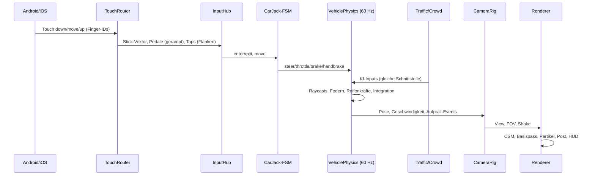

# 01 – Gesamtarchitektur, Engine-Entscheidung & Budgets

**Projekt:** Project V-Mobile · **Dokumenttyp:** Technische Spezifikation (TDD) · **Status:** v1.0

---

## 1. Engine-Entscheidung

| Kriterium | Unreal Engine 5.4+ | Unity 6 (URP) | Godot 4.5 (Vertical Slice) |
|---|---|---|---|
| Open-World-Streaming | World Partition, HLOD, Data Layers, Level Instances | Addressables + eigenes Streaming | eigenes Chunk-Streaming (implementiert) |
| Mobile-Renderer | Mobile Deferred / Forward, CSM, Distance-Field-Schatten (ab SM5/ES3.1 eingeschränkt) | URP Forward+, CSM, SSAO | Mobile-Renderer (Vulkan), PSSM 4 Splits |
| Fahrzeugphysik | Chaos Vehicles (Basis) + eigener Raycast-Controller | eigener Raycast-Controller | eigener Raycast-Controller (implementiert) |
| Crowd/Traffic | Mass Entity + ZoneGraph + Mass Traffic | DOTS/ECS | leichtgewichtige Agenten (implementiert) |
| Build-Pipeline | Horde/BuildGraph, braucht eigene Build-Agents | Unity Build Server / Game-CI (Lizenz) | GitHub-Hosted Runner, ohne Lizenz |
| **Entscheidung** | **Produktions-Engine** | Alternative | **Prototyp + automatische APK** |

**Begründung:** UE5 bietet für ein GTA-artiges Open World die reifste Toolchain: World Partition, HLOD, Mass AI, Niagara, Material-Layering und PSO-Caching. Deshalb sind alle C++-Skizzen in diesem Plan für UE5 geschrieben.

UE5 lässt sich jedoch nicht auf einem kostenlosen GitHub-Runner bauen: Es braucht einen mit Epic verknüpften GitHub-Account für das Engine-Image, das Image ist über 100 GB groß, und das Ganze dauert Stunden. Der **Vertical Slice** ist deshalb in Godot 4.5 umgesetzt, mit **identischer Architektur**: dieselben State Machines, dasselbe Input-Routing, dasselbe Fahrzeugmodell. So entsteht bei jedem Push eine echte, installierbare APK, und die Mechaniken lassen sich auf echter Hardware testen. Siehe `08_Prototyp_Mapping.md`.

---

## 2. Schichtenarchitektur

```
┌─────────────────────────────────────────────────────────────────────┐
│ Presentation    HUD (Touch-Widgets, Minimap, Tacho) · Menüs · Audio  │
├─────────────────────────────────────────────────────────────────────┤
│ Input Layer     TouchRouter (Finger-Ownership) → InputHub (normiert) │
│                 Tastatur / Gamepad / Neigungssensor → InputHub        │
├─────────────────────────────────────────────────────────────────────┤
│ Gameplay        PlayerCharacter · CarJack-FSM · Combat · Wanted(*)    │
│                 VehiclePawn (Raycast-Physik) · CameraRig              │
├─────────────────────────────────────────────────────────────────────┤
│ Simulation      TrafficSubsystem · CrowdSubsystem · WeatherSubsystem  │
│                 TimeOfDay · TrafficLights · Panic/Event-Bus           │
├─────────────────────────────────────────────────────────────────────┤
│ World           WorldStreaming (Chunks/Cells) · HLOD · Occlusion      │
│                 Prozedurale/handgebaute Zellen · Kollision            │
├─────────────────────────────────────────────────────────────────────┤
│ Platform        DeviceProfiles/Tiering · DynRes · PSO-Cache · Telemetry│
└─────────────────────────────────────────────────────────────────────┘
(*) außerhalb des Vertical-Slice-Umfangs
```

**Regeln**

1. **Kein Gameplay-Code liest Touch-Events direkt.** Alles läuft über die normierte Input-Schicht (`UVMInputHub`, im Prototyp `InputHub`).
2. **Einmalige Ereignisse laufen über den Event-Bus** (`Panic`, `VehicleEntered`, `CarjackStarted` …). Kein System hält harte Referenzen auf ein anderes System, nur um es zu benachrichtigen.
3. **Simulationssysteme sind Subsysteme** (UE: `UWorldSubsystem`/`UTickableWorldSubsystem`), keine Actors in der Welt.
4. **Deterministische Prozedur-Daten:** Alles, was gestreamt wird, lässt sich aus `(CellCoord, Seed)` reproduzieren. Gespeichert werden nur Abweichungen (bewegte Autos, Schäden).

---

## 3. UE5-Modulstruktur (Produktion)

```
Source/
├── VMobileCore/          Basistypen, Event-Bus (UVMEventSubsystem), DeviceTier
├── VMobileInput/         UVMTouchRouter, UVMInputHub, Enhanced-Input-Mapping
├── VMobileVehicles/      AVMVehiclePawn, UVMRaycastVehicleComponent, UVMTireModel
├── VMobileCharacters/    AVMCharacter, UVMCarJackComponent, Motion-Warping-Setup
├── VMobileAI/            Mass-Traffic-Fragmente, Crowd-Processors, Panic-Signal
├── VMobileWorld/         Weather/TimeOfDay-Subsysteme, Streaming-Policies
├── VMobileUI/            UMG-Widgets (CommonUI), HUD-Layout-Editor
└── VMobileEditor/        QA-Commandlets (Textur-Streaming, LOD-Budget, PSO-Abdeckung)
```

**Tick-Gruppen (UE5)**

| Tick Group | Systeme |
|---|---|
| `TG_PrePhysics` | InputHub-Auswertung, CarJack-FSM, KI-Fahrer (setzen Fahrzeug-Inputs) |
| `TG_DuringPhysics` / Async Physics | Raycast-Fahrzeug (Async Physics Tick, feste 60 Hz) |
| `TG_PostPhysics` | Kamera-Rig, Rad-Visuals, Audio-Parameter |
| `TG_PostUpdateWork` | HUD-Daten, Telemetrie |

**Threading:** Physik und Animation laufen parallel (Chaos-Async, Animation-Worker-Threads), Mass-Processors laufen über den Task-Graph. Der Game-Thread bleibt für Gameplay-Logik frei.

---

## 4. Frame- und Speicherbudgets (Ziel: High-Tier, 60 FPS = 16,6 ms)

| Bereich | Game Thread | Render Thread | GPU |
|---|---|---|---|
| Gameplay + KI + Physik | 5,5 ms | – | – |
| Animation | 1,5 ms | – | – |
| Sichtbarkeit/Culling | – | 2,0 ms | – |
| Draw-Submit (≤ 900 Draws) | – | 4,0 ms | – |
| Schatten (4 CSM-Kaskaden) | – | – | 3,0 ms |
| Basispass + Beleuchtung | – | – | 6,5 ms |
| Transparenz/Partikel (Regen) | – | – | 1,5 ms |
| Post (Tonemap, Bloom, AA) | – | – | 1,5 ms |
| **Reserve (Thermik!)** | 2,0 ms | 2,0 ms | 2,0 ms |

**Speicher (High-Tier, 8–12 GB RAM):** Gesamtbudget 2,2 GB. Davon Texturen 900 MB (Streaming-Pool), Meshes 450 MB, Audio 120 MB, Physik/KI 150 MB, Rest/Code 580 MB.
**Mid-Tier (6 GB):** 1,5 GB gesamt, Texturpool 550 MB.

**Thermik:** Mobile-SoCs drosseln nach 5–10 min Volllast. Deshalb ist das 60-FPS-Ziel mit **20 % GPU-Reserve** geplant. Die dynamische Auflösung (siehe `02_Rendering_Pipeline.md` §7) fängt den Rest ab.

---

## 5. Geräte-Tiering

| Tier | Referenzgeräte | FPS | Renderskala | CSM | Schattendistanz | Verkehr / Passanten | Effekte |
|---|---|---|---|---|---|---|---|
| **High** | iPhone 15/16 Pro, Galaxy S23/S24 Ultra (Adreno 740/750), Dimensity 9200+ (Immortalis) | 60 | 0,85–1,0 (DynRes) | 4 | 140 m | 13 / 22 | Screen-Drops, Bloom, 7 echte Straßenlichter |
| **Medium** | Adreno 650–730, Mali-G78/G710 | 60 | 0,7–0,8 | 4 | 100 m | 9 / 14 | Bloom, 5 Lichter |
| **Low** | darunter | 30 | 0,55–0,7 | 2 | 60 m | 5 / 8 | keine Screen-Drops, FXAA statt MSAA |

Die Erkennung läuft zweistufig: (1) **statische Heuristik** über GPU-Name/SoC (Device-Profile-Regeln, im Prototyp `GameConfig._detect_tier`). (2) **Laufzeit-Regelung** über die gemessene Frame-Zeit (`QualityManager`). Der Spieler kann das Tier im Menü überschreiben.

UE5 `DefaultDeviceProfiles.ini` (Auszug):

```ini
[Android_High DeviceProfile]
DeviceType=Android
BaseProfileName=Android
+CVars=r.MobileContentScaleFactor=0
+CVars=r.ScreenPercentage=90
+CVars=r.DynamicRes.OperationMode=2
+CVars=r.Shadow.CSM.MaxMobileCascades=4
+CVars=r.Shadow.DistanceScale=1.0
+CVars=r.Shadow.MaxCSMResolution=2048
+CVars=r.MSAACount=4
+CVars=r.Mobile.AmbientOcclusion=1
+CVars=r.Mobile.EnableMovableSpotlightsShadow=0
+CVars=fx.Niagara.QualityLevel=3
+CVars=vm.Traffic.MaxVehicles=13
+CVars=vm.Crowd.MaxAgents=22

[Android_Mid DeviceProfile]
BaseProfileName=Android_High
+CVars=r.ScreenPercentage=75
+CVars=r.Shadow.DistanceScale=0.7
+CVars=r.MSAACount=2
+CVars=fx.Niagara.QualityLevel=2
+CVars=vm.Traffic.MaxVehicles=9
+CVars=vm.Crowd.MaxAgents=14

[Android_Low DeviceProfile]
BaseProfileName=Android_Mid
+CVars=r.ScreenPercentage=60
+CVars=r.Shadow.CSM.MaxMobileCascades=2
+CVars=r.Shadow.DistanceScale=0.45
+CVars=r.MSAACount=1
+CVars=r.Mobile.AntiAliasing=1
+CVars=t.MaxFPS=30
+CVars=vm.Traffic.MaxVehicles=5
+CVars=vm.Crowd.MaxAgents=8

; Zuordnung per GPU-Regex (Auszug)
[/Script/AndroidDeviceProfileSelector.AndroidDeviceProfileMatchingRules]
+MatchProfile=(Profile="Android_High",Match=((SourceType=SRC_GpuFamily,CompareType=CMP_Regex,MatchString="Adreno \\(TM\\) (7[3-9]\\d|8\\d\\d)")))
+MatchProfile=(Profile="Android_High",Match=((SourceType=SRC_GpuFamily,CompareType=CMP_Regex,MatchString="Immortalis|Mali-G7[1-9]\\d")))
+MatchProfile=(Profile="Android_Mid",Match=((SourceType=SRC_GpuFamily,CompareType=CMP_Regex,MatchString="Adreno \\(TM\\) (6[4-9]\\d|7[0-2]\\d)|Mali-G(68|7[6-8])")))
+MatchProfile=(Profile="Android_Low",Match=((SourceType=SRC_GpuFamily,CompareType=CMP_Regex,MatchString=".*")))
```

---

## 6. Datenfluss eines Frames (High-Tier)


