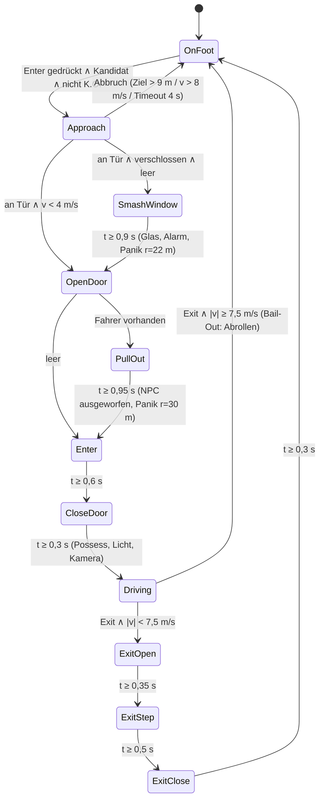
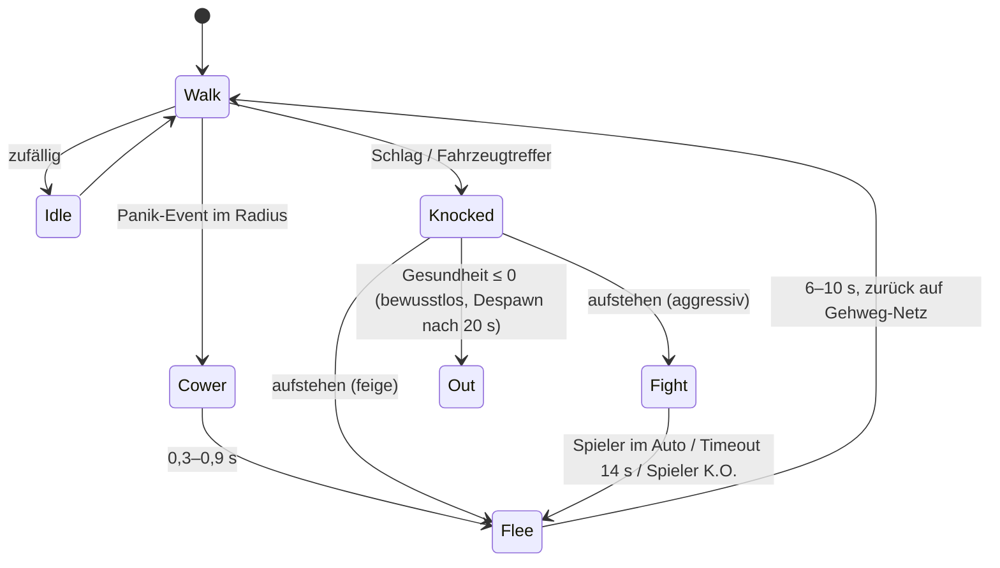

# 03 – Car-Jacking: State Machine, Animation, NPC-Reaktion

Ziel: nahtloses Einsteigen und Fahrzeugdiebstahl, wie man es aus dem Genre kennt. Herantreten → kontextueller Button → Tür aufreißen → Fahrer herausziehen → hinters Steuer → Kamera blendet in die Verfolgungsansicht. Ohne Clipping, ohne Teleport-Pops, robust gegen rollende Fahrzeuge und Abbrüche.

---

## 1. Zustandsdiagramm



**Eigenschaften**

* Jeder Zustand ist **zeitgesteuert und deterministisch** (Timer, keine Abhängigkeit von Animations-Callbacks für Korrektheit). Animation-Notifies lösen nur Effekte aus (Sound, Partikel).
* Alle Transformationen werden **relativ zum Fahrzeug** interpoliert (`Lerp(Start, Fahrzeug→Socket)` pro Frame neu). Rollt das Auto während der Sequenz, folgt die Figur → kein Clipping.
* **Kollision der Figur ist während Enter/Exit deaktiviert.** Die Kapsel wird erst am freien Ausstiegspunkt reaktiviert (vorher Overlap-Test, Fallback-Punkt auf der Beifahrerseite).
* **Abbruchbedingungen** sind explizit (Approach). Ab `OpenDoor` ist die Sequenz verbindlich (wie im Genre üblich), sie kann nur durch Zerstörung des Fahrzeugs abbrechen (`ForceOnFoot`).

---

## 2. Kontextueller Button (Kandidatensuche)

```
Kandidat = argmin_v  min( |P − DoorSocket(v)| , |P − Center(v)| − ½·Länge(v) )
Bedingungen: aufrecht (Up·Z > 0,6) ∧ Distanz < 4,5 m ∧ v.speed < 10 m/s
Abfrage-Rate: 10 Hz über Spatial Hash (UE: Overlap-Sphere auf Channel "Vehicle")
```

UI: Der Button „Einsteigen“ pulsiert rechts über dem Schlag-Button (siehe `04_Mobile_UI_UX.md`). Der Text wechselt zwischen „Einsteigen“, „Einsteigen (verschlossen)“ und „Fahrzeug klauen“ (besetzt).

---

## 3. UE5-Implementierung

### 3.1 Komponente & Zustände

```cpp
// VMobileCharacters/Public/VMCarJackComponent.h
#pragma once
#include "Components/ActorComponent.h"
#include "VMCarJackComponent.generated.h"

class AVMVehiclePawn;
class AVMCharacter;

UENUM(BlueprintType)
enum class EVMCarJackState : uint8
{
    OnFoot, Approach, SmashWindow, OpenDoor, PullOut,
    Enter, CloseDoor, Driving, ExitOpen, ExitStep, ExitClose
};

USTRUCT()
struct FVMCarJackTimings
{
    GENERATED_BODY()
    UPROPERTY(EditAnywhere) float Smash = 0.9f;
    UPROPERTY(EditAnywhere) float Open = 0.38f;
    UPROPERTY(EditAnywhere) float Pull = 0.95f;
    UPROPERTY(EditAnywhere) float Enter = 0.6f;
    UPROPERTY(EditAnywhere) float Close = 0.3f;
    UPROPERTY(EditAnywhere) float ExitOpen = 0.35f;
    UPROPERTY(EditAnywhere) float ExitStep = 0.5f;
    UPROPERTY(EditAnywhere) float ExitClose = 0.3f;
};

DECLARE_DYNAMIC_MULTICAST_DELEGATE_TwoParams(FOnCarJackStateChanged, EVMCarJackState, Old, EVMCarJackState, New);

UCLASS(ClassGroup=(VMobile), meta=(BlueprintSpawnableComponent))
class VMOBILECHARACTERS_API UVMCarJackComponent : public UActorComponent
{
    GENERATED_BODY()
public:
    UVMCarJackComponent();
    virtual void TickComponent(float Dt, ELevelTick, FActorComponentTickFunction*) override;

    UFUNCTION(BlueprintCallable) bool RequestEnterOrExit();       // vom InputHub (Flanke)
    UFUNCTION(BlueprintPure)     AVMVehiclePawn* GetCandidate() const { return Candidate.Get(); }
    UFUNCTION(BlueprintPure)     EVMCarJackState GetState() const { return State; }
    bool CameraFollowsVehicle() const;

    UPROPERTY(BlueprintAssignable) FOnCarJackStateChanged OnStateChanged;

    UPROPERTY(EditDefaultsOnly) FVMCarJackTimings T;
    UPROPERTY(EditDefaultsOnly) float EnterRange = 450.f;      // cm
    UPROPERTY(EditDefaultsOnly) float MaxJackSpeed = 400.f;    // cm/s
    UPROPERTY(EditDefaultsOnly) float BailSpeed = 750.f;       // cm/s
    UPROPERTY(EditDefaultsOnly) TObjectPtr<UAnimMontage> M_Smash, M_OpenDoor, M_PullOut, M_Enter, M_Exit, M_Bail;

private:
    void SetState(EVMCarJackState S);
    void TickApproach(float Dt);
    void TickPullOut();
    void BeginEnter();
    void FinishExit();
    void BailOut();
    void Abort(const FText& Reason);
    AVMVehiclePawn* FindCandidate() const;
    FTransform SeatXf() const;
    FTransform DoorStandXf() const;

    EVMCarJackState State = EVMCarJackState::OnFoot;
    float StateTime = 0.f;
    TWeakObjectPtr<AVMVehiclePawn> Vehicle, Candidate;
    TWeakObjectPtr<AVMCharacter> Victim;
    FTransform FromXf, VictimFromXf;
    bool bSmashed = false, bVictimReleased = false;
    float CandidateTimer = 0.f;
};
```

### 3.2 Tick (Kern der State Machine)

```cpp
// VMobileCharacters/Private/VMCarJackComponent.cpp (Auszug)
static float SmoothStep01(float X) { X = FMath::Clamp(X, 0.f, 1.f); return X * X * (3.f - 2.f * X); }

void UVMCarJackComponent::TickComponent(float Dt, ELevelTick Tick, FActorComponentTickFunction* Fn)
{
    Super::TickComponent(Dt, Tick, Fn);
    StateTime += Dt;
    AVMCharacter* Me = CastChecked<AVMCharacter>(GetOwner());

    if (State != EVMCarJackState::OnFoot && !Vehicle.IsValid()) { ForceOnFoot(); return; }
    AVMVehiclePawn* V = Vehicle.Get();

    switch (State)
    {
    case EVMCarJackState::OnFoot:
        if ((CandidateTimer -= Dt) <= 0.f) { CandidateTimer = 0.1f; Candidate = FindCandidate(); }
        break;

    case EVMCarJackState::Approach:
        TickApproach(Dt);
        break;

    case EVMCarJackState::SmashWindow:
        if (!bSmashed && StateTime > T.Smash * 0.5f)
        {
            bSmashed = true;
            V->SetLocked(false);
            V->TriggerAlarm(8.f);
            V->SpawnGlassBurst(EVMDoor::Driver);
            GetWorld()->GetSubsystem<UVMEventSubsystem>()->BroadcastPanic(V->GetActorLocation(), 2200.f);
        }
        if (StateTime >= T.Smash) SetState(EVMCarJackState::OpenDoor);
        break;

    case EVMCarJackState::OpenDoor:
        V->SetDoorOpenAlpha(EVMDoor::Driver, SmoothStep01(StateTime / T.Open));
        if (StateTime >= T.Open)
        {
            if (V->HasNPCDriver()) { /* PullOut vorbereiten */ Victim = V->DetachDriver(); VictimFromXf = Victim->GetActorTransform();
                                     bVictimReleased = false; SetState(EVMCarJackState::PullOut); }
            else BeginEnter();
        }
        break;

    case EVMCarJackState::PullOut:
        TickPullOut();
        if (StateTime >= T.Pull) BeginEnter();
        break;

    case EVMCarJackState::Enter:
    {
        const float K = SmoothStep01(StateTime / T.Enter);
        FTransform Xf; Xf.Blend(FromXf, SeatXf(), K);                  // Sitz-Socket jedes Frame neu
        Xf.AddToTranslation(FVector(0, 0, FMath::Sin(K * PI) * 25.f));   // Schweller-Bogen
        Me->SetActorTransform(Xf, false, nullptr, ETeleportType::TeleportPhysics);
        if (StateTime >= T.Enter) SetState(EVMCarJackState::CloseDoor);
        break;
    }
    case EVMCarJackState::CloseDoor:
        Me->SetActorTransform(SeatXf());
        V->SetDoorOpenAlpha(EVMDoor::Driver, 1.f - SmoothStep01(StateTime / T.Close));
        if (StateTime >= T.Close)
        {
            Me->GetController()->Possess(V);          // Input geht jetzt an das Fahrzeug
            V->SetDriver(Me);
            Me->SetHiddenInGame(V->HasOpaqueGlass()); // Draw-Calls sparen
            SetState(EVMCarJackState::Driving);
        }
        break;

    case EVMCarJackState::Driving:
        Me->SetActorTransform(SeatXf());
        break;

    case EVMCarJackState::ExitOpen:
        V->SetHandbrake(true);
        V->SetDoorOpenAlpha(EVMDoor::Driver, SmoothStep01(StateTime / T.ExitOpen));
        if (StateTime >= T.ExitOpen) { FromXf = SeatXf(); Me->SetHiddenInGame(false); SetState(EVMCarJackState::ExitStep); }
        break;

    case EVMCarJackState::ExitStep:
    {
        const float K = SmoothStep01(StateTime / T.ExitStep);
        FTransform Xf; Xf.Blend(FromXf, DoorStandXf(), K);
        Me->SetActorTransform(Xf);
        if (StateTime >= T.ExitStep) SetState(EVMCarJackState::ExitClose);
        break;
    }
    case EVMCarJackState::ExitClose:
        V->SetDoorOpenAlpha(EVMDoor::Driver, 1.f - SmoothStep01(StateTime / T.ExitClose));
        if (StateTime >= T.ExitClose) FinishExit();
        break;
    }
}

bool UVMCarJackComponent::RequestEnterOrExit()
{
    if (State == EVMCarJackState::OnFoot && Candidate.IsValid())
    {
        Vehicle = Candidate;
        bSmashed = false;
        if (UVMTrafficDriverFragmentAccess* AI = Vehicle->GetTrafficDriver()) AI->RequestStop();  // KI bremst
        GetWorld()->GetSubsystem<UVMEventSubsystem>()->OnCarjackStarted.Broadcast(Vehicle.Get());
        SetState(EVMCarJackState::Approach);
        return true;
    }
    if (State == EVMCarJackState::Driving)
    {
        if (FMath::Abs(Vehicle->GetForwardSpeed()) < BailSpeed) SetState(EVMCarJackState::ExitOpen);
        else BailOut();
        return true;
    }
    return false;
}
```

### 3.3 Approach mit Motion Warping

Die Figur läuft per **Pfad + Steering** zum Tür-Socket. In den letzten 35 cm übernimmt **Motion Warping**: Root-Motion der Montage wird so verzerrt, dass Hand ↔ Türgriff exakt passen, egal aus welchem Winkel man kommt.

```cpp
void UVMCarJackComponent::TickApproach(float Dt)
{
    AVMCharacter* Me = CastChecked<AVMCharacter>(GetOwner());
    AVMVehiclePawn* V = Vehicle.Get();
    const FVector Door = V->GetDoorStandLocation(EVMDoor::Driver);       // Socket "door_l_stand"
    FVector To = Door - Me->GetActorLocation(); To.Z = 0.f;

    if (V->GetVelocity().Size() > MaxJackSpeed + 400.f || To.Size() > 900.f || StateTime > 4.f)
    { Abort(NSLOCTEXT("VM", "TooFar", "Zu weit weg")); return; }

    if (To.Size() < 35.f && V->GetVelocity().Size() < MaxJackSpeed)
    {
        UMotionWarpingComponent* MW = Me->GetMotionWarping();
        MW->AddOrUpdateWarpTargetFromTransform(TEXT("DoorHandle"), V->GetSocketTransform(TEXT("door_l_handle")));
        MW->AddOrUpdateWarpTargetFromTransform(TEXT("Seat"),       SeatXf());
        const bool bLocked = V->IsLocked() && !V->HasNPCDriver();
        Me->PlayAnimMontage(bLocked ? M_Smash : M_OpenDoor);
        SetState(bLocked ? EVMCarJackState::SmashWindow : EVMCarJackState::OpenDoor);
        return;
    }
    Me->AddMovementInput(To.GetSafeNormal(), FMath::Clamp(To.Size() / 150.f, 0.35f, 1.f));
}
```

### 3.4 Herausziehen des Fahrers (NPC-Auswurf)

```cpp
void UVMCarJackComponent::TickPullOut()
{
    AVMCharacter* NPC = Victim.Get();
    if (!NPC) return;
    const float K = SmoothStep01(StateTime / (T.Pull * 0.7f));
    const FVector Out = Vehicle->GetDoorStandLocation(EVMDoor::Driver) + Vehicle->GetDriverSideOut() * 140.f;
    FTransform Target(Vehicle->GetDriverSideOut().Rotation(), Out);
    FTransform Xf; Xf.Blend(VictimFromXf, Target, K);
    Xf.AddToTranslation(FVector(0, 0, FMath::Sin(K * PI) * 35.f));
    NPC->SetActorTransform(Xf);

    if (StateTime >= T.Pull * 0.75f && !bVictimReleased)
    {
        bVictimReleased = true;
        // Übergabe an Ragdoll-Blend (Physical Animation, 0,4 s) und danach an die Crowd-KI
        NPC->StartPhysicalHitReaction(Vehicle->GetDriverSideOut() * 250.f, /*BlendTime*/ 0.4f);
        UVMCrowdSubsystem* Crowd = GetWorld()->GetSubsystem<UVMCrowdSubsystem>();
        Crowd->AdoptEjectedDriver(NPC, NPC->GetPersonality()); // Flucht- oder Angriffs-KI
        GetWorld()->GetSubsystem<UVMEventSubsystem>()->BroadcastPanic(Vehicle->GetActorLocation(), 3000.f);
        Victim.Reset();
    }
}
```

### 3.5 Absprung bei Tempo (Bail-Out)

```cpp
void UVMCarJackComponent::BailOut()
{
    AVMCharacter* Me = CastChecked<AVMCharacter>(GetOwner());
    AVMVehiclePawn* V = Vehicle.Get();
    const FVector Vel = V->GetVelocity(), Side = V->GetDriverSideOut();
    Me->GetController()->Possess(Me);
    V->SetDriver(nullptr);                     // rollt antriebslos weiter (kein Handbremsen)
    V->SetDoorOpenAlpha(EVMDoor::Driver, 1.f); // schließt per Feder-Animation
    Me->SetActorLocation(V->GetDoorStandLocation(EVMDoor::Driver) + Side * 40.f + FVector(0, 0, 30.f));
    Me->EnableCollisionAfterOverlapCheck();
    Me->LaunchIntoTumble(Vel * 0.55f + Side * 300.f + FVector(0, 0, 250.f), /*Seconds*/ 1.5f); // Abrollen
    Me->ApplyDamage(8.f);
    Vehicle.Reset();
    SetState(EVMCarJackState::OnFoot);
}
```

---

## 4. Kamera während der Sequenz

| Zustand | Kamera |
|---|---|
| Approach / Smash / Open / PullOut | Zu-Fuß-Kamera, Fokus auf die Figur, leichte Dolly-Annäherung |
| Enter → CloseDoor → Driving | **Blend 0,6 s** (Smoothstep) von Figur-Fokus zu Fahrzeug-Fokus, Armlänge 3,8 → 6,2 m. Die Kamera-Kollision schließt ab dem Blend das eigene Fahrzeug aus |
| Driving | Verfolgungskamera, Auto-Recenter nach 1 s ohne Swipe, FOV 68° → 82° mit Tempo |
| ExitOpen | bleibt am Fahrzeug, danach Blend zurück |

---

## 5. NPC-Reaktion



**Persönlichkeit** (beim Spawn gewürfelt, beim Fahrer 35 % aggressiv): bestimmt Fight vs. Flee.

**Panik-Ausbreitung:** Ein Event `Panic(Ort, Radius)` geht über den Event-Bus. UE: Mass-Signal an alle Crowd-Entities in der Zelle, Prototyp: Signal an alle Passanten. Kein O(n²): räumliche Vorfilterung über Grid-Zellen.

| Auslöser | Radius |
|---|---|
| Scheibe einschlagen | 22 m |
| Fahrer herausziehen | 30 m |
| Fahrzeug-Crash (> 6 m/s) | 18 m |
| Schlag / Treffer | 14 m |
| Passant angefahren | 20 m |

---

## 6. Randfälle (Testmatrix)

| # | Situation | Erwartetes Verhalten | Abgesichert durch |
|---|---|---|---|
| 1 | Auto rollt während Enter | Figur folgt dem Sitz-Socket, kein Clipping | relative Interpolation |
| 2 | Auto fährt während Approach weg | Abbruch mit Hinweis | Abbruchbedingungen |
| 3 | Auto liegt auf dem Dach | kein Kandidat | `IsUpright`-Filter |
| 4 | Ausstiegspunkt blockiert (Wand) | Beifahrerseite, sonst Dach-Ausstieg | Overlap-Test (UE) |
| 5 | Spieler wird während Approach getroffen | Approach läuft weiter, Knockdown erst danach | Knockdown nur im OnFoot |
| 6 | Fahrzeug wird während der Sequenz zerstört/despawnt | `ForceOnFoot`, Figur am Boden | Gültigkeitsprüfung pro Tick |
| 7 | Ausstieg bei hoher Geschwindigkeit | Bail-Out mit Tumble + Schaden | Geschwindigkeitsschwelle |
| 8 | Verschlossenes Auto | Scheibe einschlagen, Alarm, Panik | SmashWindow |
| 9 | Aggressiver Fahrer | steht auf, greift an, flieht wenn Spieler wegfährt | Crowd-FSM |
| 10 | Doppeltipp auf Enter | Flanke wird einmal verarbeitet, Rest verworfen | Edge-Queue im InputHub |

Alle zehn Fälle haben im Prototyp einen automatisierten Smoke-Test-Schritt (`game/scripts/tests/smoke_test.gd`) oder sind durch die genannten Mechanismen strukturell ausgeschlossen. Ausnahme ist #4: Die Overlap-Fallback-Logik ist nur in der UE5-Spezifikation beschrieben.
