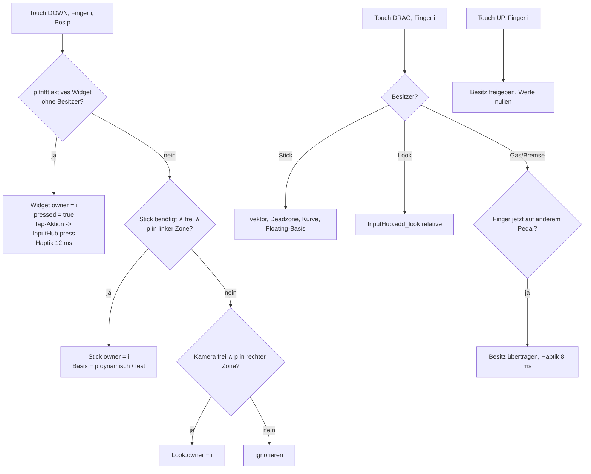

# 04 – Mobile UI/UX: Daumengerechtes HUD für Fahrzeug & Zu-Fuß

Grundsätze: Touchscreens haben kein haptisches Feedback und keine Ruhestellung. Deshalb gilt:

1. **Große, fehlertolerante Trefferflächen.** Mindestens 48 dp, primäre Aktionen 72–96 dp, Trefferfläche ≥ 118 % der sichtbaren Fläche.
2. **Thumb-Zones statt fester Pixelpositionen.** Alles relativ zur Safe-Area und zu den Bildschirmecken.
3. **Finger-Besitz:** Ein Finger gehört ab dem Aufsetzen genau einem Element. Gleitet er heraus, bleibt die Aktion bestehen (sticky), außer zwischen Gas und Bremse (Gleiten erlaubt).
4. **Digital → analog:** Digitale Touch-Pedale werden zeitlich gerampt (Gas 0→1 in 150 ms, Bremse in 100 ms). Lenkung bekommt Response-Kurven und geschwindigkeitsabhängige Begrenzung.
5. **Kontextuelle Elemente** erscheinen nur bei Bedarf (Einsteigen) und pulsieren, ohne die Daumenposition zu ändern.
6. **Haptik:** 12 ms beim Tippen, 8 ms beim Pedalwechsel, 25–120 ms bei Treffern und Crashs (skaliert).

---

## 1. Ergonomie-Modell (Landscape, beidhändig)

```
 ┌──────────────────────────────────────────────────────────────────────────┐
 │  [Minimap]                     12:30 · Regen          [Radio][Kam][Exit][II]│ ← „Reichzone" (Dehnung)
 │  [Gesundheit]                                                              │
 │                                                                            │
 │                                                                            │
 │   ░░░░░░░░░░░░░░░░░░░                         ▓▓▓▓▓▓▓▓▓▓▓▓▓▓▓▓▓▓▓▓▓▓▓      │
 │   ░ linke Daumenzone ░                         ▓ rechte Daumenzone  ▓      │ ← „Komfortzone"
 │   ░  (Bewegung/Lenk.) ░                        ▓ (Aktionen/Pedale)  ▓      │   Bogen um den
 │   ░░░░░░░░░░░░░░░░░░░                         ▓▓▓▓▓▓▓▓▓▓▓▓▓▓▓▓▓▓▓▓▓▓▓      │   Daumenballen
 └──────────────────────────────────────────────────────────────────────────┘
```

* Komfortzone: Kreisbogen mit r ≈ 25–30 mm um die untere Bildschirmecke (Daumen-Drehpunkt), auf typischen 6,1–6,8″-Geräten ≈ 300–380 logische px bei 720 px Höhe.
* **Primäraktion (Schlag / Gas)** liegt dort, wo der rechte Daumen ruht. Sekundäraktionen folgen auf dem Bogen nach innen und oben.
* **Selten genutzte Aktionen** (Radio, Kamera, Pause, Aussteigen) liegen oben rechts in der Reichzone, damit man sie nicht versehentlich trifft.

Referenz-Layout in logischen Pixeln (Basis 1280×720, `stretch=canvas_items/expand`, HUD-Skalierung S = 0,7–1,4). Implementiert in `game/scripts/input/touch_controls.gd` (`_layout()`).

---

## 2. Fahrzeug-Modus

```
 ┌──────────────────────────────────────────────────────────────────────────┐
 │ ┌──────┐            19:24 · Gewitter      ( ♫ )( ◙ )(⇥Tür)        (II)  │
 │ │ MAP  │                                  Radio Kamera Aussteigen  Pause │
 │ └──────┘                                                                   │
 │ ▬▬▬▬▬▬ HP                                                                  │
 │                                                    ( H )  Handbremse      │
 │   ◄ ╭──────╮ ►                                     ┌─────┐ ┌───────┐       │
 │     │  ◉   │   Lenk-Stick (dynamisch,              │BREM-│ │       │       │
 │     ╰──────╯   nur horizontal ausgewertet)         │ SE  │ │  GAS  │       │
 │                                  ╭──╮              │ / R │ │       │       │
 │                                  │87│ km/h  3      └─────┘ └───────┘       │
 │                                  ╰──╯ Tacho                                │
 └──────────────────────────────────────────────────────────────────────────┘
```

| Element | Größe (S=1) | Position | Verhalten |
|---|---|---|---|
| **Gas** | 130 × 190 px Pill (≈ 18 × 26 mm) | unten rechts, 28 px Rand | Halten; Rampe 150 ms; Daumen kann zur Bremse gleiten |
| **Bremse / Rückwärts** | 120 × 150 px | links neben Gas, 22 px Abstand | Halten; bei < 1 m/s automatisch Rückwärtsgang („/R“) |
| **Handbremse / Drift** | Ø 104 px | über der Lücke Gas/Bremse (Daumen kippt nach oben) | Halten; reduziert Hinterachsgrip auf 10 % |
| **Aussteigen** | Ø 84 px | oben rechts | Tap; unter 7,5 m/s Aussteigen, darüber Absprung |
| **Kamera** | Ø 68 px | oben rechts | Tap: Nah → Weit → Cinematic |
| **Radio** | Ø 68 px | oben rechts | Tap: Sender wechseln |
| **Lenkung** | Stick r = 95 px | linke Zone, dynamisch | siehe Steuerungsmodi |

### Lenk-Modi (Menü → „Lenkung“)

| Modus | Eingabe | Aufbereitung |
|---|---|---|
| **Virtueller Stick** (Standard) | X-Achse des dynamischen Sticks | Deadzone 7 %, Kurve `x^1.35` (feinfühlig um die Mitte), Basis folgt dem Daumen („Floating“) |
| **Links/Rechts-Tasten** | zwei Ø 140 px Buttons | Rampe 3,2/s hin, 6/s zurück (wirkt wie analoges Lenken) |
| **Neigung (Gyro)** | Schwerkraftvektor in Bildschirmkoordinaten | Kalibrierung (Neutrallage), ±26° = voller Einschlag, Deadzone 6 %, Tiefpass τ ≈ 70 ms, Invertier-Option |

Für alle Modi gilt fahrzeugseitig: **geschwindigkeitsabhängiger Maximal-Lenkwinkel** (36° im Stand → 30 % davon ab 137 km/h), **Lenkraten-Limit** (2,4 rad/s hin, 4,5 rad/s zurück) und ein **Gegenlenk-Assistent** (bis 0,3 rad Richtung tatsächlicher Bewegung). Siehe `05_Touch_Input_und_Fahrzeugphysik.md`.

---

## 3. Zu-Fuß-Modus

```
 ┌──────────────────────────────────────────────────────────────────────────┐
 │ ┌──────┐            12:30 · Klar                                    (II)  │
 │ │ MAP  │                                                                   │
 │ └──────┘                     ←— Kamera: Wischen auf der rechten Hälfte —→  │
 │ ▬▬▬▬▬▬ HP                                                  ✦( 🚗→ )✦      │
 │                                                             Einsteigen    │
 │   ╭──────╮  dynamischer Stick:                   ( » )   (pulsiert, nur   │
 │   │  ◉   │  erscheint, wo der                   Sprint    wenn Kandidat)  │
 │   ╰──────╯  Daumen landet                               ┌──────┐         │
 │                                              ( ▲ )      │ FAUST│         │
 │                       „Fahrzeug klauen"      Sprung     │Schlag│         │
 │                                                          └──────┘         │
 └──────────────────────────────────────────────────────────────────────────┘
```

| Element | Größe | Position | Verhalten |
|---|---|---|---|
| **Bewegungs-Stick** | r = 95 px | erscheint am Aufsetzpunkt (linke 42 % der Breite, unter dem oberen Viertel) | Deadzone 12 %, Basis folgt bei Überzug; Ausschlag → Gehen (0,5 m/s) … Joggen (4,6 m/s) |
| **Kamera** | gesamte rechte Hälfte (außer Buttons) | – | Wischen: 0,0042 rad/px × Empfindlichkeit; Pitch −72°…+34°; Invertier-Option |
| **Schlag** | Ø 136 px | Daumen-Ruheposition | Tap (Cooldown 0,45 s) |
| **Sprung** | Ø 96 px | links unten vom Schlag | Tap |
| **Sprint** | Ø 92 px | links oben vom Schlag | Halten (Sprint = 7,2 m/s × Stickausschlag) |
| **Einsteigen** | Ø 112 px, pulsierend | über dem Schlag | erscheint nur bei Fahrzeug in 4,5 m. Text darunter: „Einsteigen“ / „Einsteigen (verschlossen)“ / „Fahrzeug klauen“ |

---

## 4. Safe-Area, Skalierung, Barrierefreiheit

* **Safe-Area:** `DisplayServer.get_display_safe_area()` (UE: `FDisplayMetrics::TitleSafePaddingSize`). Alle Elemente richten sich an den Kanten der Safe-Area aus (Notch, Punch-Hole, abgerundete Ecken, Gestenleiste).
* **HUD-Skalierung** 70–140 % (Menü). Positionen und Größen skalieren gemeinsam, die Daumenbögen bleiben erhalten.
* **Linkshänder-Spiegelung** (Produktion): Layout-Spiegelung um die vertikale Achse als Option.
* **HUD-Editor** (Produktion): Jedes Element ist per Drag verschiebbar und pro Element skalierbar, mit Raster-Snap und Kollisionsvermeidung zwischen Elementen. Gespeichert pro Gerät, Reset auf Standard.
* **Kontrast:** Weiße Icons auf 38 % schwarzem Grund mit 55 % weißem Rand → lesbar auf hellem Himmel und auf Nacht-Neon. Gas grün, Bremse rot (zusätzlich beschriftet, also nicht nur über Farbe unterscheidbar).
* **Vibration abschaltbar**, Kamera-Y invertierbar, Neigung invertierbar und kalibrierbar.

---

## 5. Multi-Touch-Router (Ablauf)



Die C++-Fassung des Routers steht in `05_Touch_Input_und_Fahrzeugphysik.md` §1.

---

## 6. Kamera-UX

* **Zu Fuß:** Schulterkamera mit 3,8 m Armlänge, SpringArm-Kollision. Kein Auto-Recenter, damit der Spieler die Kontrolle behält.
* **Im Fahrzeug:** Auto-Recenter hinter die **Bewegungsrichtung** (nicht die Fahrzeugachse → Drifts wirken natürlich), sobald 1 s lang nicht gewischt wurde. Rate steigt mit dem Tempo. FOV 68° → 82° mit dem Tempo (Geschwindigkeitsgefühl). Aufprall → Kamera-Shake + Haptik proportional zur Aufprallstärke.
* **Modi:** Nah (6,2 m), Weit (9,5 m), Cinematic (8 m, langsame Orbit-Schwenks, FOV 52°).
* **Übergang Zu-Fuß ↔ Fahrzeug:** 0,6 s Smoothstep-Blend von Fokus, Armlänge und FOV. Keine harten Schnitte.

---

## 7. Pause- & Einstellungsmenü

Alle Einstellungen werden sofort angewendet und in `user://settings.cfg` gespeichert. Bei geänderter Qualitätsstufe werden die Systeme live neu konfiguriert.

| Einstellung | Optionen |
|---|---|
| Lenkung | Virtueller Stick · Links/Rechts-Tasten · Neigung (Gyro) |
| Stick | Dynamisch (folgt Daumen) · Fest |
| Grafikqualität | Automatisch · Niedrig (30 FPS) · Mittel · Hoch |
| Wetter | Automatisch · Klar · Regen · Gewitter |
| Tageszeit | Zyklus (24 min) · Morgen · Mittag · Abend · Nacht |
| Kamera-Empfindlichkeit | 0,3–2,5 |
| HUD-Größe | 70–140 % |
| Schalter | Kamera Y invertieren · Neigung invertieren · Vibration · FPS/Debug |
| Aktion | Neigung kalibrieren |
