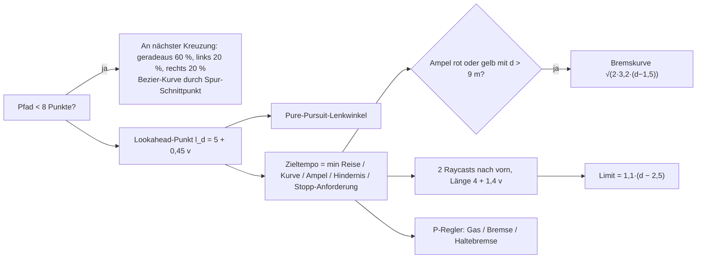

# 06 – Open-World-Struktur, Streaming & Verkehrs-/Passanten-KI

---

## 1. Weltaufbau

| Ebene | Größe | Inhalt | UE5 | Prototyp |
|---|---|---|---|---|
| Welt | 4 × 4 km (Ziel v1), erweiterbar | Downtown, Wohnviertel, Hafen, Hügel, Highway-Ring | World Partition | unendliches Raster (deterministisch) |
| Zelle / Chunk | 80 × 80 m (Prototyp), 128 m (UE-Runtime-Grid „Main“) | 1 Block + halbe Straßen | WP-Grid-Cell | `CityChunk` |
| HLOD-Ebene 1 | 512 m | zusammengefasste Gebäude, Impostor-Bäume | HLOD Layer „Buildings“ | `visibility_range_*` + Nebel |
| HLOD-Ebene 2 | 2048 m | Skyline-Silhouette | HLOD Layer „Skyline“ | Himmel/Nebel |

**Deterministische Inhalte:** Gebäude, Laternen, Ampeln, Bäume und Parkplätze ergeben sich aus `Hash(Cx, Cz, Seed)`. Handgebaute Missionsbereiche überschreiben das per Data Layer („Override-Zellen“).

### 1.1 Stadtraster (Prototyp, `city_layout.gd`)

```
 x = i·80 m                    x = (i+1)·80 m
   │◄─7 m─►│◄4 m►│            Block 58×58 m            │◄4 m►│◄─7 m─►│
   │ Fahrbahn │Geh-│  ┌──────────────────────────────┐  │Geh-│Fahrbahn│
   │ ←2 m Spur│weg │  │ Downtown 2×2 / Wohnen 3×2 /  │  │weg │Spur 2m→│
   │ 5,5 Park │    │  │ Tower / Park                 │  │    │Park 5,5│
   │          │    │  └──────────────────────────────┘  │    │        │
```

* Rechtsverkehr, eine Spur pro Richtung (Mitte ±2 m), Parkstreifen bei ±5,5 m, Gehweg 7–11 m.
* Blocktyp aus Hash + Distanz zum Zentrum: Park 12 %, Tower (r < 320 m) 20 %, Downtown (r < 480 m), sonst Wohngebiet. Die Höhen fallen mit der Distanz zum Zentrum (Skyline-Effekt).

---

## 2. Streaming-Architektur

### 2.1 Regeln

1. **Lade-Radius** um den *vorausberechneten* Fokus: `Fokus = Position + Geschwindigkeit · 2,5 s`. Bei 140 km/h wird also ~100 m voraus geladen.
2. **Priorität** nach Distanz zum vorausberechneten Fokus.
3. **Zeitscheiben:** maximal **1 Zellaufbau pro Frame** (Prototyp). UE: Async-Loading + `s.LevelStreamingComponentsRegistrationGranularity`, Budget 2 ms/Frame für Registrierung.
4. **Hysterese:** Entladen erst bei Radius + 1. Kein Flattern an Zellgrenzen.
5. **Kollision unabhängig vom Streaming:** globale Bodenebene (Prototyp) bzw. immer geladene, stark vereinfachte „Collision-Only“-Zellen (UE Data Layer `DL_CollisionProxy`).
6. **Sichtgrenze < Streaming-Radius:** Exponentieller Nebel erreicht vor der Ladegrenze ~95 % Dichte. Lade-Pop-In ist damit unsichtbar.

| Tier | Radius (Zellen) | geladene Zellen | Sichtweite (Nebel) |
|---|---|---|---|
| High | 3 | 7×7 = 49 | ~280 m |
| Mid/Low | 2 | 5×5 = 25 | ~200 m |

### 2.2 UE5 World Partition (Produktion)

```ini
; DefaultEngine.ini
[/Script/Engine.WorldPartitionSubsystem]
wp.Runtime.EnableStreaming=1
wp.Runtime.BlockOnSlowStreaming=0              ; nie Game-Thread blockieren
wp.Runtime.MaxLoadingStreamingCells=2          ; Mobile: wenige parallele Zellen
wp.Runtime.UpdateStreaming.LocationQuantization=400
wp.Runtime.HLOD.WarmupEnabled=1                ; HLOD vor Zellwechsel vorwärmen -> kein Pop

; Runtime-Grids (WorldSettings)
; Main:       CellSize=12800  LoadingRange=25600 (High) / 19200 (Mid)
; Props:      CellSize=6400   LoadingRange=9600   (kleine Requisiten, Data Layer DL_Props)
; Vehicles:   CellSize=12800  LoadingRange=19200  (parkende Autos als Mass-Spawner)
```

**Streaming-Quelle mit Vorlauf** (statt nur Spielerposition):

```cpp
// AVMPlayerController : IWorldPartitionStreamingSourceProvider
bool AVMPlayerController::GetStreamingSources(TArray<FWorldPartitionStreamingSource>& Out) const
{
    const APawn* P = GetPawn();
    if (!P) return false;
    const FVector Lead = P->GetVelocity() * 2.5f;                       // 2,5 s Vorlauf
    FWorldPartitionStreamingSource& S = Out.AddDefaulted_GetRef();
    S.Name = TEXT("PlayerLead");
    S.Location = P->GetActorLocation() + Lead;
    S.Rotation = P->GetActorRotation();
    S.TargetState = EStreamingSourceTargetState::Activated;
    S.Priority = EStreamingSourcePriority::High;
    S.bBlockOnSlowLoading = false;
    S.Velocity = P->GetVelocity().Size();
    return true;
}
```

---

## 3. Verkehrs-KI

### 3.1 Architektur (UE5: Mass Entity + ZoneGraph)

```
ZoneGraph (Fahrspuren, Kreuzungen, Ampelphasen)
   │
Mass Traffic Processors ─► LOD 0 (≤ 60 m): volle Raycast-Physik (gleicher Controller wie Spieler)
   │                       LOD 1 (≤ 180 m): kinematisch auf Spur, keine Physik
   │                       LOD 2 (> 180 m): nur Simulation, Instanced-Mesh-Darstellung
   └─► Spawn/Despawn außerhalb des Frustums, Dichte aus DeviceProfile (vm.Traffic.MaxVehicles)
```

**Prototyp (implementiert):** 5/9/13 fahrende Autos (Low/Mid/High). Alle laufen mit voller Raycast-Physik (gleiche `Vehicle`-Klasse wie das Spielerauto), der KI-Fahrer setzt dieselben normierten Eingaben. Gespawnt wird 70–170 m entfernt, außerhalb des Frustums, mit Mindestabstand 10 m. Despawn bei > 230 m, bei 12 s Feststecken oder auf dem Dach außer Sicht.

### 3.2 Entscheidungslogik pro KI-Fahrer



**Panik:** Rammt der Spieler ein KI-Auto, fährt die KI 8 s lang mit 17 m/s und ignoriert Ampeln (Flucht). Beim Car-Jacking stoppt die KI (`request_stop`), damit der Diebstahl gelingt.

---

## 4. Passanten-KI

| Aspekt | Umsetzung |
|---|---|
| Wegenetz | Rundwege auf den Gehwegen jedes Blocks (Bogenlänge `s`, deterministisch aus Chunk-Koordinate). UE: ZoneGraph-Fußgängerspuren + Smart Objects (Bänke, Ampeln) |
| Zustände | Walk, Idle, Cower, Flee, Fight, Knocked, Out (siehe `03_CarJacking_StateMachine.md` §5) |
| Dichte | 8/14/22 (Low/Mid/High). Spawn 28–110 m, außerhalb des Frustums innerhalb 70 m. Despawn > 150 m |
| Kosten | Prototyp: CharacterBody pro Passant (~22). UE: Mass Crowd mit **Vertex-Animation-Textures** ab 25 m (1 Draw-Call pro Kleidungs-Variante), Skelett-Animation nur in den nächsten 8 m |
| Physik-Interaktion | Fahrzeuge kollidieren nicht physikalisch mit Figuren (verhindert Abprallen). Treffer per OBB-Test → Knockdown mit Impuls aus der Fahrzeuggeschwindigkeit |

---

## 5. Leistungsanpassung zur Laufzeit

```
Frame-Zeit > Budget·1,12 (1 s)  → Renderskala −5 %   (Untergrenze 55 %)
Frame-Zeit < Budget·0,82 (4 s)  → Renderskala +5 %   (Obergrenze = Tier-Maximum)
Thermik-Warnung (OS)             → Obergrenze −10 %, Verkehrsdichte −30 %
Speicherwarnung (OS)             → Lade-Radius −1, Texturpool −25 %, Passanten −50 %
```

Prototyp: `QualityManager` (Renderskala + FSR 1.0, MSAA je Tier, FPS-Cap 30/60). Verkehrs- und Passantendichte sowie Lichtbudget und Partikelzahl richten sich nach dem Tier.
