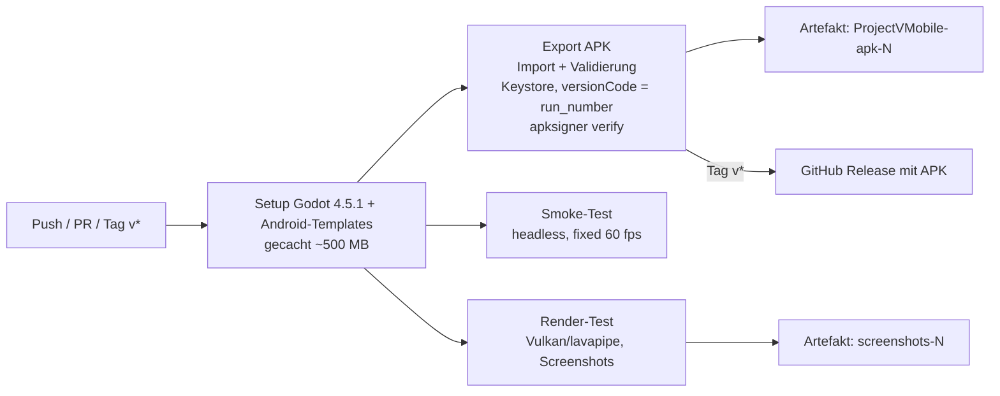

# 07 – QA, Performance-Gates, CI/CD & Roadmap

---

## 1. Qualitäts-Gates (jeder Build)

| Gate | Prüfung | Werkzeug | Status im Prototyp |
|---|---|---|---|
| G1 Kompilierung | Alle Skripte und Shader kompilieren | `tools/ci_import.sh` (Import + Validierung im Spielkontext mit Autoloads) | ✅ aktiv |
| G2 Gameplay-Smoke | Laufen, Einsteigen, Fahren, Driften, Bremsen, Aussteigen, KI-Stopp, Car-Jacking mit Fahrerauswurf, Absprung, Wetter, Nacht, Streaming, Passanten, Physik-Integrität (NaN/Out-of-Bounds) | `scripts/tests/smoke_test.gd` headless, `--fixed-fps 60` (deterministische Simulationszeit) | ✅ aktiv |
| G3 Rendering | Shader im echten Vulkan-Mobile-Pfad, 4 Referenzszenen, Bildstatistik (Mittelwert/Streuung gegen schwarze/leere Frames) | `scripts/tests/render_test.gd` + Software-Vulkan (lavapipe) + Xvfb | ✅ aktiv, Screenshots als Artefakt |
| G4 APK | Export, Signaturprüfung (`apksigner verify`), Paket-Metadaten (`aapt2 dump badging`) | GitHub Actions | ✅ aktiv |
| G5 Performance (Produktion) | Frame-Zeit-Perzentile auf Gerätefarm (P50/P95/P99), Thermik-Kurve 20 min | Firebase Test Lab / AWS Device Farm + Perfetto/Unreal Insights | geplant |
| G6 Visuelle Regression (Produktion) | SSIM gegen Golden Images pro Szene ≥ 0,97 | Render-Test-Erweiterung | geplant |
| G7 Content-Budgets (Produktion) | Tri-/LOD-/Textur-Budgets, PSO-Abdeckung ≥ 98 % | UE-Commandlets (siehe `02_Rendering_Pipeline.md` §6) | geplant |

---

## 2. Performance-Budgets & Messpunkte

| Messgröße | High (60 FPS) | Mid (60 FPS) | Low (30 FPS) |
|---|---|---|---|
| Frame P95 | ≤ 16,6 ms | ≤ 16,6 ms | ≤ 33,3 ms |
| Frame P99 (Hitch-Grenze) | ≤ 25 ms | ≤ 28 ms | ≤ 45 ms |
| Draw-Calls | ≤ 900 | ≤ 650 | ≤ 400 |
| Sichtbare Dreiecke | ≤ 1,4 Mio | ≤ 0,9 Mio | ≤ 0,5 Mio |
| RAM (PSS) | ≤ 2,2 GB | ≤ 1,5 GB | ≤ 1,1 GB |
| Ladezeit Kaltstart → spielbar | ≤ 12 s | ≤ 15 s | ≤ 20 s |
| Zellaufbau pro Frame | ≤ 2 ms | ≤ 2 ms | ≤ 3 ms |
| Akku (30 min, 60 % Helligkeit) | ≤ 14 % | ≤ 14 % | ≤ 12 % |

**Prototyp-Debug-Overlay** (Menü → „FPS/Debug anzeigen“): FPS, gemittelte Frame-Zeit, aktuelle Renderskala, Tier, GPU-Name.

---

## 3. CI/CD-Pipeline

### 3.1 Prototyp (GitHub Actions, `.github/workflows/android-apk.yml`)



* **Signierung:** Ohne Secrets wird eine **debug-signierte** APK gebaut. Der Debug-Keystore liegt im Actions-Cache, damit Folge-Builds sich ohne Deinstallation über alte installieren lassen (solange der Cache lebt). Mit den Repository-Secrets `ANDROID_KEYSTORE_BASE64`, `ANDROID_KEYSTORE_PASSWORD` und `ANDROID_KEY_ALIAS` wird automatisch eine **release-signierte** APK erzeugt.
* **Versionierung:** `versionCode` = laufende Build-Nummer, `versionName` = `0.1.<Build>`.
* **Releases:** Ein Tag `v0.1.0` (o. ä.) erzeugt ein GitHub-Release mit angehängter APK.

### 3.2 Produktion (UE5)

| Stufe | Inhalt | Infrastruktur |
|---|---|---|
| Pre-Submit | Compile (Win/Linux Editor), Unit-Tests (`Automation RunTests VMobile.*`), Content-Validatoren | Horde-Agents (selbst gehostet) |
| Nightly | Android/iOS-Cook (ASTC, PSO-Bundle), Gerätefarm-Läufe (Smoke + Performance-Route), Golden-Image-Vergleich | Horde + Device Farm |
| Weekly | Soak-Test 2 h, Speicherleck-Analyse (Memreport-Diff), Thermik-Run | Gerätelabor |
| Release | AAB-Build, Play Asset Delivery (Install-Time + On-Demand-Packs), App-Store-Build | Release-Pipeline |

```bash
# BuildGraph-Kern (vereinfacht)
RunUAT.sh BuildCookRun -project=VMobile.uproject -platform=Android -cookflavor=ASTC \
  -clientconfig=Shipping -build -cook -stage -pak -iostore -archive -archivedirectory=Out/Android \
  -compressed -prereqs -nodebuginfo -distribution
```

---

## 4. Roadmap (Produktion mit UE5)

| Phase | Dauer | Ergebnis | Exit-Kriterium |
|---|---|---|---|
| **0 – Prototyp** | erledigt | Godot-Vertical-Slice mit APK-CI (dieses Repo) | Kernmechaniken auf echter Hardware spielbar |
| **1 – Tech-Foundation** | 3 Monate | UE5-Projekt, Module laut `01`, Raycast-Fahrzeug, TouchRouter, CarJack-Komponente, Device-Profiles | 60 FPS auf High-Referenzgerät in Testkarte, alle Gates G1–G4 |
| **2 – Rendering & Welt** | 4 Monate | Master-Materialien mit Wetter, CSM-Tuning, Downtown-Block (1 km²), World Partition + HLOD | G5–G7 grün, 0 bekannte Rendering-Bugs Klasse A |
| **3 – KI & Systeme** | 4 Monate | Mass Traffic + Crowd, Ampeln, Panik, Polizei/Fahndung, Schadensmodell | 13 Fahrzeuge + 22 Passanten bei ≤ 5,5 ms Game Thread |
| **4 – Content-Ausbau** | 6 Monate | 4×4 km Stadt, 25 Fahrzeugmodelle, Missionen, Audio/Radio | Content-Budgets eingehalten |
| **5 – Polish & Launch** | 3 Monate | Optimierung, Lokalisierung, Store-Release, LiveOps-Backend | Crash-Free-Rate ≥ 99,5 %, P95 im Budget auf 90 % der Zielgeräte |

**Team-Kern (Phase 1–2):** 1 Lead Engine/Rendering, 2 Gameplay (C++), 1 Physik/Fahrzeuge, 1 Tools/Build, 1 Tech-Artist, 2 Environment-Artists, 1 UX-Designer, 1 QA-Engineer (Automatisierung).

---

## 5. Risiko-Register

| Risiko | Wahrscheinlichkeit | Auswirkung | Gegenmaßnahme |
|---|---|---|---|
| Thermik-Drosselung senkt FPS nach 10 min | hoch | hoch | 20 % GPU-Reserve, DynRes mit Thermik-Signal, 30-FPS-Fallback-Profil |
| Shader-Kompilier-Hitches | mittel | hoch | PSO-Precaching + gebündelter Cache, Prewarm im Ladebildschirm |
| Treiber-Bugs (Vulkan auf Mali/Adreno) | mittel | mittel | Gerätefarm-Nightly, GLES-Fallback, Blocklist im DeviceProfile |
| Touch-Steuerung zu ungenau für Fahrzeuge | mittel | hoch | 3 Lenkmodi, Assists (speed-sensitiv, Ratenlimit, Gegenlenken), Playtests ab Phase 1 |
| Speicherdruck auf 6-GB-Geräten | mittel | hoch | Streaming-Radius/Texturpool im Mid-Profil, Memory-Warnungen behandeln |
| Rechtliches: Nähe zu bekannten Marken | mittel | hoch | Eigene Stadt, eigene Fahrzeugdesigns und Namen, keine Logos/Marken; „im Stil von“ nur auf Genre-Ebene |
